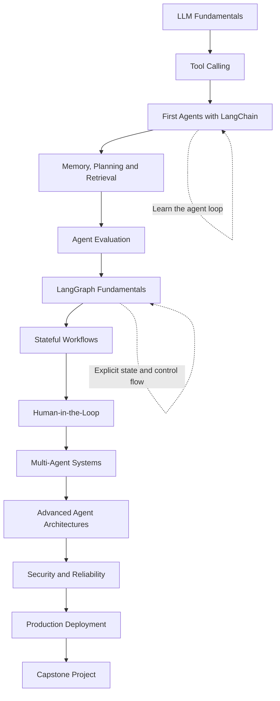
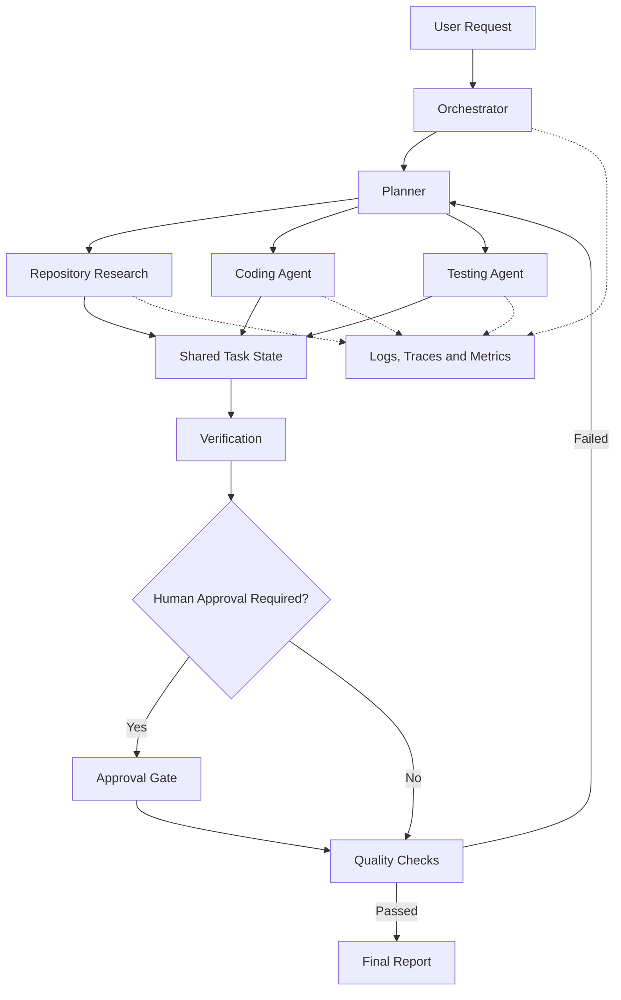

 <div align="center">

# 🤖 AI Agents: From Zero to Advanced

### A free, open-source, hands-on course on building, evaluating, and deploying AI agents with LangChain and LangGraph

**Understand. Build. Evaluate. Orchestrate. Deploy.**

[](https://github.com/HosseinHeydari2004/AI-Agents-From-Zero-to-Advanced/stargazers)
[](https://github.com/HosseinHeydari2004/AI-Agents-From-Zero-to-Advanced/network/members)
[](LICENSE)
[](https://www.python.org/)
[](CONTRIBUTING.md)

**🇬🇧 English** | [🇮🇷 فارسی](README.fa.md)

[Quick Start](#-quick-start) •
[Lessons](#-curriculum) •
[Projects](#-project-based-learning) •
[Roadmap](#-roadmap) •
[Contributing](#-contributing)

</div>

---

## 🤔 What is this?

AI agents are systems that use language models to reason about a task, select tools, take actions, observe results, and decide what to do next.

Unlike a traditional LLM application that follows a mostly predefined sequence, an agent can dynamically choose among available actions within a defined set of instructions, tools, and execution limits.

This repository is a practical learning path from your first tool-calling agent to advanced, stateful, multi-agent systems that can be evaluated, monitored, and deployed.

You will start with **LangChain**, progress to **LangGraph**, and eventually combine both to build reliable agentic applications.

```text
User: "Investigate this GitHub repository and explain its architecture."

Agent:
  1. Understand the request
  2. Identify the required information
  3. Select repository inspection tools
  4. Read relevant files
  5. Analyze the code and dependencies
  6. Verify its findings
  7. Produce an answer with file references

Result: An evidence-based engineering report.
```

The goal is not simply to make an LLM call tools. It is to understand how to design, control, evaluate, and deploy systems that use models to make decisions.

---

## ✨ Why this course?

| | |
|---|---|
| 🪜 **Progressive learning** | Start with basic LLM calls and build toward advanced agent architectures. |
| 🛠️ **Project-based** | Every major stage introduces practical implementations rather than isolated theory. |
| 🧠 **Understand the fundamentals** | Learn what happens underneath framework abstractions before relying on them. |
| 🔀 **LangChain + LangGraph** | Learn straightforward agent loops first, then introduce explicit state, routing, persistence, and orchestration. |
| 📏 **Evaluation first** | Measure correctness, tool selection, task completion, latency, and cost before optimizing. |
| 🛡️ **Reliability and safety** | Explore bounded execution, structured outputs, permissions, human approval, and prompt injection defenses. |
| 🚀 **Production-oriented** | Progress toward APIs, observability, deployment, testing, and maintainable code. |
| 🌍 **Open-source collaboration** | Learn publicly, contribute exercises, improve documentation, and share projects. |

---

## 🗺️ The big picture



---

## 🚀 Quick Start

### Option 1: Google Colab

Open a lesson notebook and run it in Google Colab when a Colab link is available.

### Option 2: Run locally

```bash
# 1. Clone the repository
git clone https://github.com/HosseinHeydari2004/AI-Agents-From-Zero-to-Advanced.git

cd AI-Agents-From-Zero-to-Advanced

# 2. Create a virtual environment
python -m venv .venv

# Windows
.venv\Scripts\activate

# Linux / macOS
source .venv/bin/activate

# 3. Install dependencies
pip install -r requirements.txt

# 4. Start Jupyter
jupyter lab
```

Some lessons may have their own dependency files to keep framework versions isolated.

### API keys

Never commit API keys, access tokens, or other secrets.

Use environment variables or a local `.env` file that is excluded from Git:

```text
OPENAI_API_KEY=your_key_here
```

The actual value must never be committed. Where practical, lessons will include local models or other low-cost alternatives.

---

## 📚 Curriculum

**Status legend:** ✅ Available · 🚧 In progress · 📅 Planned

The curriculum is organized into progressive levels. Planned lessons are not necessarily implemented yet.

### Level 0 — Foundations of AI Agents

**Goal:** Understand what an agent is before building one.

| # | Lesson | What you learn | Status |
|---|---|---|---|
| 00 | Your First LLM Application | Send a prompt and inspect a model response | 📅 |
| 01 | How LLMs Work | Messages, roles, tokens, context windows, model limitations | 📅 |
| 02 | What Is an AI Agent? | Models, tools, observations, actions, and control loops | 📅 |
| 03 | Workflows vs. Agents | Deterministic pipelines versus dynamic decision-making | 📅 |
| 04 | Agent Architectures | ReAct, tool-calling agents, planners, and routers | 📅 |
| 05 | Agent Design Principles | Scope, constraints, stopping conditions, and failure modes | 📅 |

**Milestone:** Explain the architecture of an agent and identify when an agent is unnecessary.

### Level 1 — LLM Engineering Essentials

**Goal:** Build the components on which agents depend.

| # | Lesson | What you learn | Status |
|---|---|---|---|
| 06 | Model Interfaces | Chat models, messages, and model configuration | 📅 |
| 07 | Prompt Engineering | Instructions, context, examples, and output constraints | 📅 |
| 08 | Structured Outputs | Pydantic schemas, validation, and typed responses | 📅 |
| 09 | Tool Calling Fundamentals | Tool schemas, arguments, results, and execution | 📅 |
| 10 | Context Management | Context limits, summarization, and information selection | 📅 |
| 11 | Model Selection | Capability, latency, cost, and local inference | 📅 |

**Milestone:** Build reusable, typed LLM components that can be used inside agent systems.

### Level 2 — Your First Agents with LangChain

**Goal:** Build agents and understand their execution loop without introducing LangGraph yet.

| # | Lesson | What you build | Status |
|---|---|---|---|
| 12 | LangChain Fundamentals | Models, messages, prompts, and runnables | 📅 |
| 13 | Defining Tools | Python functions exposed as model-callable tools | 📅 |
| 14 | Tool-Calling Agent | An agent that selects and executes tools | 📅 |
| 15 | Understanding the Agent Loop | Model → tool → observation → model | 📅 |
| 16 | Tool Selection and Routing | Multiple tools and appropriate tool selection | 📅 |
| 17 | Structured Agent Responses | Typed results and output validation | 📅 |
| 18 | Execution Limits | Iteration limits, timeouts, and error handling | 📅 |

**Project 01: Calculator Agent**

Build an agent that decides when to use mathematical tools, executes calculations in Python, and returns validated results.

**Project 02: Research Assistant**

Build an agent that searches approved sources, retrieves relevant information, and produces an answer with references.

### Level 3 — Agent Memory, Retrieval, and Planning

**Goal:** Build agents that work with longer conversations, external knowledge, and multi-step tasks.

| # | Lesson | What you build | Status |
|---|---|---|---|
| 19 | Conversation History | Multi-turn interactions | 📅 |
| 20 | Short-Term Memory | Maintaining relevant conversation context | 📅 |
| 21 | Long-Term Memory | Persisting selected information across sessions | 📅 |
| 22 | Memory Design | What to store, retrieve, update, or discard | 📅 |
| 23 | Planning and Decomposition | Breaking tasks into manageable subtasks | 📅 |
| 24 | ReAct Agents | Reasoning and acting through tool interactions | 📅 |
| 25 | Reflection and Verification | Checking outputs and correcting errors | 📅 |
| 26 | RAG-Enabled Agents | Combining retrieval with tool use | 📅 |
| 27 | Agent and Workflow Routing | Selecting specialized execution paths | 📅 |

**Project 03: Personal Productivity Agent**

Build an assistant that handles supported tasks using tools, preserves selected user preferences, and validates its actions.

**Project 04: Documentation Intelligence Agent**

Build an agent that searches a documentation repository, answers technical questions with references, and identifies missing information.

### Level 4 — Agent Evaluation and Testing

**Goal:** Measure whether an agent actually completes tasks correctly.

| # | Lesson | What you learn | Status |
|---|---|---|---|
| 28 | Evaluation Fundamentals | Define success criteria and test cases | 📅 |
| 29 | Tool Selection Metrics | Measure appropriate tool selection and argument correctness | 📅 |
| 30 | Task Completion | Evaluate final outcomes against expected results | 📅 |
| 31 | Trajectory Evaluation | Inspect intermediate tool calls and execution paths | 📅 |
| 32 | LLM-as-a-Judge | Use model-based evaluators with appropriate safeguards | 📅 |
| 33 | Regression Testing | Detect failures after code, prompt, or model changes | 📅 |
| 34 | Tracing and Debugging | Inspect prompts, tool calls, outputs, and errors | 📅 |
| 35 | Cost and Latency | Track tokens, response time, and execution cost | 📅 |

**Project 05: Agent Evaluation Benchmark**

Create a dataset of representative tasks, compare agent configurations, and produce a report covering success rate, tool errors, latency, and cost.

Possible tools include LangSmith and custom Python evaluation scripts.

### Level 5 — LangGraph Fundamentals

**Goal:** Move from an implicit agent loop to explicit, controllable execution graphs.

| # | Lesson | What you learn | Status |
|---|---|---|---|
| 36 | Why LangGraph? | When stateful graph orchestration is useful | 📅 |
| 37 | State and Typed State | Define the data shared between nodes | 📅 |
| 38 | Nodes and Edges | Model work as functions and transitions | 📅 |
| 39 | Conditional Routing | Route execution according to state | 📅 |
| 40 | Loops and Termination | Build bounded iterative workflows | 📅 |
| 41 | Checkpointing | Save and restore execution state | 📅 |
| 42 | Persistence and Threads | Resume conversations and executions | 📅 |
| 43 | Interrupts and Human Approval | Pause execution for human decisions | 📅 |
| 44 | Streaming | Stream events and intermediate updates | 📅 |
| 45 | Failure Recovery | Handle errors, retries, and resumable execution | 📅 |

**Project 06: Stateful Research Agent**

Build a research agent with explicit state, conditional routing, bounded research loops, checkpointing, and resumable execution.

### Level 6 — Advanced Agent Patterns

**Goal:** Choose and combine architectures according to the task.

| # | Lesson | What you learn | Status |
|---|---|---|---|
| 46 | Router Agents | Route requests to specialized workflows | 📅 |
| 47 | Parallel Execution | Run independent tasks concurrently | 📅 |
| 48 | Map-Reduce Agents | Process many items and aggregate findings | 📅 |
| 49 | Plan-and-Execute | Separate task planning from execution | 📅 |
| 50 | Reflection Loops | Revise outputs against explicit quality criteria | 📅 |
| 51 | Supervisor Architecture | Coordinate specialized agents | 📅 |
| 52 | Handoffs | Transfer control between agents | 📅 |
| 53 | Hierarchical Agents | Organize multi-level delegation | 📅 |
| 54 | Dynamic Routing | Select execution paths at runtime | 📅 |
| 55 | Hybrid Architectures | Combine deterministic workflows and autonomous decisions | 📅 |

**Project 07: Multi-Agent Research System**

Build a system with specialized research agents, parallel information gathering, a synthesis stage, and a final verification step.

### Level 7 — Multi-Agent Systems Engineering

**Goal:** Understand the trade-offs and failure modes of systems with multiple agents.

| # | Lesson | What you learn | Status |
|---|---|---|---|
| 56 | Single Agent vs. Multi-Agent | Decide when additional agents are justified | 📅 |
| 57 | Agent Communication | Define messages and handoff contracts | 📅 |
| 58 | Shared vs. Private State | Manage information boundaries | 📅 |
| 59 | Coordination and Dependencies | Control execution order and dependencies | 📅 |
| 60 | Conflicts and Verification | Resolve disagreements and validate claims | 📅 |
| 61 | Agent Termination | Prevent endless delegation and loops | 📅 |
| 62 | Multi-Agent Evaluation | Measure end-to-end quality and coordination overhead | 📅 |
| 63 | Cost Optimization | Balance parallelism, model calls, and latency | 📅 |

**Project 08: Software Engineering Multi-Agent System**

Create specialized agents for codebase exploration, implementation planning, testing, and review. Require verification before accepting changes.

### Level 8 — Advanced Integrations and Agentic Applications

**Goal:** Connect agents to real tools, data sources, and external systems.

| # | Lesson | What you learn | Status |
|---|---|---|---|
| 64 | Advanced RAG Integration | Retrieval, citations, and evidence verification | 📅 |
| 65 | MCP Fundamentals | Connect agents to standardized external tool servers | 📅 |
| 66 | GitHub Integration | Inspect repositories, issues, and pull requests | 📅 |
| 67 | Browser and Search Tools | Research with controlled external access | 📅 |
| 68 | SQL and Structured Data | Query databases with validation and permissions | 📅 |
| 69 | File and Document Agents | Process supported files and extract information | 📅 |
| 70 | Event-Driven Agents | Trigger workflows from events and queues | 📅 |
| 71 | Multimodal Agents | Work with supported image, audio, and other modalities | 📅 |
| 72 | API and Service Integration | Connect agents to external applications | 📅 |

**Project 09: AI Engineering Assistant**

Build an assistant that explores a software repository, retrieves relevant documentation, investigates issues, proposes changes, and runs approved validation steps.

### Level 9 — Security, Reliability, and Guardrails

**Goal:** Design systems that fail safely and respect permission boundaries.

| # | Lesson | What you learn | Status |
|---|---|---|---|
| 73 | Prompt Injection | Identify malicious instructions in untrusted content | 📅 |
| 74 | Tool Permissions | Apply least-privilege access | 📅 |
| 75 | Human-in-the-Loop Safety | Require approval for consequential actions | 📅 |
| 76 | Input and Output Validation | Validate data at system boundaries | 📅 |
| 77 | Sandboxing | Isolate untrusted code and execution | 📅 |
| 78 | Secrets and Data Privacy | Protect credentials and sensitive information | 📅 |
| 79 | Retries and Idempotency | Prevent duplicate side effects | 📅 |
| 80 | Timeouts and Resource Limits | Bound execution and resource consumption | 📅 |
| 81 | Auditability | Record actions and decisions for investigation | 📅 |
| 82 | Failure Testing | Test malicious inputs and degraded dependencies | 📅 |

**Project 10: Secure Tool-Using Agent**

Build a constrained agent with explicit permissions, approval gates, execution limits, structured audit logs, and adversarial tests.

### Level 10 — Production Agent Engineering

**Goal:** Deploy, monitor, and maintain an agent as a real software system.

| # | Lesson | What you learn | Status |
|---|---|---|---|
| 83 | Agent Service Architecture | Separate orchestration, tools, and business logic | 📅 |
| 84 | FastAPI Integration | Expose agent capabilities through an API | 📅 |
| 85 | Docker | Package and run the application consistently | 📅 |
| 86 | Background Jobs and Queues | Handle long-running tasks | 📅 |
| 87 | Persistent Storage | Manage application data and execution records | 📅 |
| 88 | Observability | Traces, logs, metrics, and error reporting | 📅 |
| 89 | Performance Optimization | Reduce unnecessary model and tool calls | 📅 |
| 90 | Caching and Batching | Improve efficiency where appropriate | 📅 |
| 91 | Deployment and CI/CD | Test and release changes reliably | 📅 |
| 92 | Monitoring and Regression | Detect quality and reliability degradation | 📅 |
| 93 | Scaling and Resource Management | Handle concurrency and operational limits | 📅 |

**Project 11: Production-Ready Agent API**

Deploy a stateful agent behind an API, with persistence, authentication, observability, evaluation tests, and controlled execution.

### Level 11 — Frontier Topics and Advanced Research

**Goal:** Explore advanced approaches beyond conventional tool-calling agents.

| # | Lesson | What you explore | Status |
|---|---|---|---|
| 94 | Agent Harnesses | Design the execution environment around the model | 📅 |
| 95 | Context Engineering | Manage information throughout long-running tasks | 📅 |
| 96 | Long-Horizon Tasks | Break down and resume complex tasks | 📅 |
| 97 | Memory Retrieval Strategies | Retrieve and update useful long-term information | 📅 |
| 98 | Adaptive Workflows | Select strategies based on task requirements | 📅 |
| 99 | Agent Optimization | Improve quality, latency, and cost systematically | 📅 |
| 100 | Model and Tool Selection | Compare routing policies and execution strategies | 📅 |
| 101 | Computer-Use Agents | Explore controlled interaction with graphical interfaces | 📅 |
| 102 | Sandboxed Coding Agents | Execute and validate code in isolated environments | 📅 |
| 103 | Agent Benchmarks | Compare systems using reproducible task suites | 📅 |
| 104 | Agent Learning and Adaptation | Explore feedback-driven improvement and its limitations | 📅 |
| 105 | Open-Ended Agent Research | Study emerging architectures and unresolved challenges | 📅 |

**Milestone:** Design an architecture, define measurable hypotheses, run controlled experiments, and document the results.

---

## 🏗️ Project-Based Learning

The projects are designed to build on earlier lessons rather than introduce every concept at once.

| Project | Main concepts | Primary framework |
|---|---|---|
| 01. Calculator Agent | Tool calling, validation, bounded execution | LangChain |
| 02. Research Assistant | Search tools, retrieval, citations | LangChain |
| 03. Productivity Agent | Memory, structured outputs, actions | LangChain |
| 04. Documentation Agent | RAG, routing, evidence | LangChain |
| 05. Evaluation Benchmark | Metrics, tracing, regression tests | LangChain + evaluation tools |
| 06. Stateful Research Agent | Graph state, loops, checkpoints | LangGraph |
| 07. Multi-Agent Research | Delegation, parallel work, synthesis | LangGraph |
| 08. Software Engineering System | Planning, testing, review, verification | LangGraph + LangChain |
| 09. AI Engineering Assistant | MCP, GitHub, RAG, integrations | LangChain + LangGraph |
| 10. Secure Agent | Permissions, approval, sandboxing | LangChain + LangGraph |
| 11. Production Agent API | Persistence, API, monitoring, deployment | LangChain + LangGraph |
| 12. Capstone | Integrated architecture and evaluation | Combined stack |

---

## 🏆 Final Capstone — Build an Advanced AI Agent System

The final project combines the major concepts into a single, extensible application.

### Suggested project: Autonomous Software Engineering Assistant

An engineering assistant that can:

- Understand a software engineering request.
- Inspect a repository and retrieve relevant documentation.
- Plan a sequence of bounded tasks.
- Delegate suitable tasks to specialized agents.
- Execute approved tools and tests.
- Review proposed changes and verify results.
- Ask for human approval before consequential actions.
- Persist execution state and resume interrupted tasks.
- Produce a report with evidence, test results, and file references.

### Target architecture



This diagram represents a target architecture, not a claim that every component is already implemented.

### Definition of done

- [ ] Reproducible setup and documented configuration.
- [ ] Explicit state transitions and bounded execution.
- [ ] Structured outputs and input validation.
- [ ] Tool permissions and human approval for sensitive operations.
- [ ] Automated evaluation dataset and regression tests.
- [ ] Logging, tracing, and cost/latency measurements.
- [ ] API and containerized deployment.
- [ ] Documentation of limitations, failure modes, and security assumptions.

---

## 🧪 How each lesson is structured

Every lesson should follow a consistent template:

```text
🎯 Learning objectives
       ↓
🧠 Concise conceptual explanation
       ↓
💻 Step-by-step implementation
       ↓
🔍 Inspect what happens internally
       ↓
⚠️ Common mistakes and failure cases
       ↓
✍️ Hands-on exercise
       ↓
🔥 Advanced challenge
       ↓
📏 Test and evaluate
       ↓
📌 Summary and next steps
```

Guidelines:

- Introduce one major concept at a time.
- Prefer small, executable examples.
- Explain framework abstractions and relevant underlying mechanisms.
- Include expected behavior and troubleshooting guidance.
- Separate exercises from their solutions.
- Add tests when a lesson introduces important behavior.
- Avoid unnecessary abstractions in early lessons.
- Add complexity only when earlier concepts are understood.

---

## 📐 Learning principles

### 1. LangChain first, LangGraph later

Early lessons focus on understanding model calls, tools, and agent execution with LangChain.

LangGraph is introduced when explicit state, branching, loops, checkpointing, persistence, and human intervention become important.

### 2. Combine frameworks when appropriate

LangChain can provide model and tool integrations while LangGraph manages stateful orchestration. They are complementary, not competing requirements for every project.

### 3. Workflows are not always agents

A deterministic workflow is often cheaper, easier to test, and more predictable than an autonomous agent. Learn to select the simplest architecture that meets the requirements.

### 4. Evaluation is part of engineering

Do not assume that more tools, more agents, or longer reasoning automatically improve results. Compare approaches using reproducible tests.

### 5. Safety is a design requirement

An agent should not receive unrestricted access to a terminal, database, repository, or external service simply because it can call tools.

Use explicit permissions, validation, resource limits, isolation, and human approval where appropriate.

---

## 🧰 Technology stack

The exact versions will be pinned and tested as individual lessons are implemented.

| Category | Technologies |
|---|---|
| Language | Python |
| LLM orchestration | LangChain |
| Stateful orchestration | LangGraph |
| Data validation | Pydantic |
| Evaluation and tracing | LangSmith and custom evaluation scripts |
| Retrieval | Vector databases and hybrid retrieval where needed |
| Tool integration | Python tools, APIs, MCP |
| Backend | FastAPI |
| Testing | pytest |
| Packaging | Docker |
| Version control | Git and GitHub |

Not every lesson needs every dependency. Keep beginner environments lightweight and introduce additional tools only when they serve a clear learning objective.

---

## 👥 Who is this for?

This course is for:

- Python developers learning AI agent engineering.
- Students building practical LLM projects.
- RAG developers moving toward agentic systems.
- AI engineers who want to understand LangChain and LangGraph.
- Developers interested in multi-agent systems and production deployment.
- Open-source contributors who want to learn by building.

### Prerequisites

**Recommended:**

- Basic Python: functions, classes, lists, dictionaries, and exceptions.
- Familiarity with HTTP APIs and JSON.
- Basic understanding of LLMs and prompt-based applications.

Machine learning expertise is not required for the introductory levels. Advanced lessons may require additional knowledge of databases, asynchronous programming, distributed systems, or security.

---

## 📁 Repository structure

```text
AI-Agents-From-Zero-to-Advanced/
├── notebooks/              # Interactive lessons
├── lessons/                # Additional written tutorials
├── projects/               # Progressive hands-on projects
│   ├── 01-calculator-agent/
│   ├── 02-research-assistant/
│   ├── 03-productivity-agent/
│   └── ...
├── exercises/              # Practice tasks
├── solutions/              # Exercise solutions
├── src/                    # Shared utilities and components
├── tests/                  # Automated tests
├── evaluations/            # Datasets, metrics, and benchmarks
├── docs/                   # Architecture and supplementary docs
├── data/                   # Small, non-sensitive sample data
├── requirements.txt
├── .env.example
├── .gitignore
├── CONTRIBUTING.md
├── LICENSE
└── README.md
```

The repository can evolve as the course grows. Avoid creating empty directories for every planned component before there is content to put in them.

---

## 🧭 Roadmap

- [ ] **v0.1 — Foundations:** LLM fundamentals, tools, and the first LangChain agent.
- [ ] **v0.2 — Core Agents:** Routing, structured outputs, memory, and planning.
- [ ] **v0.3 — Evaluation:** Testing, tracing, task success, cost, and latency.
- [ ] **v0.4 — LangGraph:** State, nodes, edges, checkpointing, and interrupts.
- [ ] **v0.5 — Advanced Patterns:** Reflection, parallelism, and multi-agent orchestration.
- [ ] **v0.6 — Integrations:** RAG, MCP, APIs, and repository-aware agents.
- [ ] **v0.7 — Security:** Permissions, human approval, isolation, and adversarial testing.
- [ ] **v0.8 — Production:** FastAPI, Docker, observability, and deployment.
- [ ] **v0.9 — Advanced Topics:** Long-running tasks, context engineering, and agent benchmarks.
- [ ] **v1.0 — Capstone:** A documented, evaluated, deployable agent system.

The roadmap describes the intended learning path. Check individual lesson files for implementation status.

---

## 🤝 Contributing

Contributions are welcome!

You can help by:

- Fixing bugs and improving explanations.
- Adding exercises, tests, and example projects.
- Reviewing technical accuracy and framework usage.
- Translating lessons into Persian or English.
- Reporting broken instructions or dependency issues.
- Suggesting practical challenges and evaluation datasets.

Please read [CONTRIBUTING.md](CONTRIBUTING.md) before submitting a pull request.

---

## ⭐ Support the project

If this repository helps you learn:

- Star the repository.
- Share it with other developers.
- Open issues for missing topics and bugs.
- Contribute improvements and new lessons.

The goal is to make practical AI agent engineering accessible through open-source education.

---

## ❓ FAQ

<details>
<summary><b>Do I need a paid API?</b></summary>

Not necessarily. The course aims to provide local or low-cost alternatives wherever practical. Some exercises may require a particular provider or additional compute.
</details>

<details>
<summary><b>Why start with LangChain?</b></summary>

It provides a practical entry point for learning model integration and tool calling without introducing explicit graph orchestration immediately.
</details>

<details>
<summary><b>Why introduce LangGraph later?</b></summary>

Stateful, branching, resumable, and human-supervised workflows benefit from explicit orchestration. Introducing it after the agent loop makes its purpose easier to understand.
</details>

<details>
<summary><b>Will this teach multi-agent systems?</b></summary>

Yes. The advanced curriculum covers delegation, supervisors, handoffs, parallel execution, coordination, and evaluation.
</details>

<details>
<summary><b>Is this a production certification?</b></summary>

No. It is an educational, project-based repository. Completing it can help develop practical skills, but production readiness depends on testing, security, operational experience, and the application itself.
</details>

<details>
<summary><b>Are all lessons available now?</b></summary>

No. The curriculum is the intended roadmap. Refer to the status markers and implemented lesson files for what is currently available.
</details>

<details>
<summary><b>What language are the lessons written in?</b></summary>

The intended approach is Persian explanations with English code, identifiers, and technical terminology, alongside an English README and opportunities for community translation.
</details>

---

## 👨‍💻 Author

**Hossein Heydari**

Computer Engineering student interested in LLMs, RAG, AI agents, and practical AI engineering.

- [GitHub](https://github.com/HosseinHeydari2004)
- [LinkedIn](https://www.linkedin.com/in/hossein-heydari2004)

## 📄 License

Released under the [MIT License](LICENSE).

---

<div align="center">

**Learn it. Build it. Evaluate it. Deploy it.**

Made for the open-source AI engineering community.

</div>
